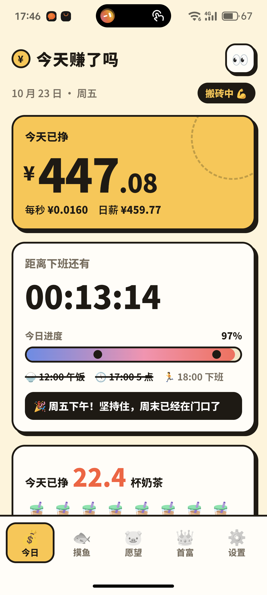
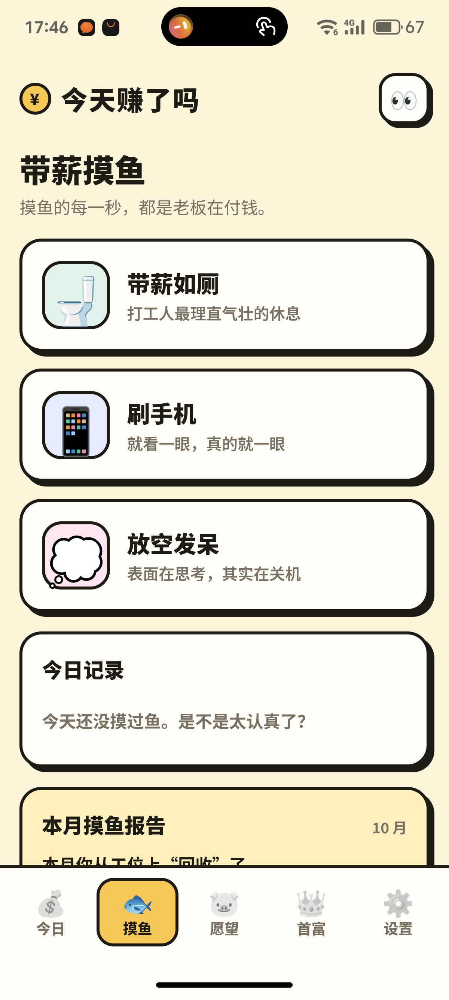
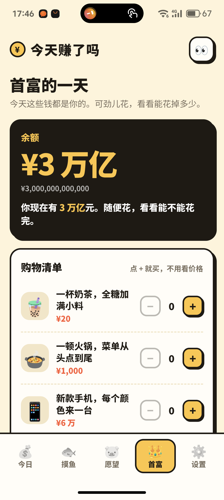
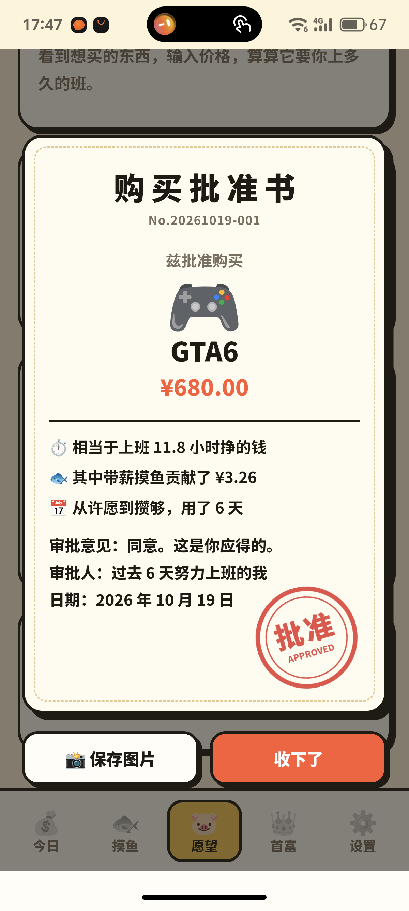
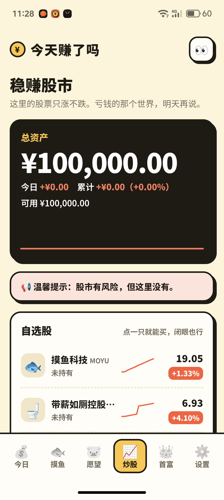

# 今天赚了吗

打工人薪资计算器，安卓 App。打开就能看到今天已经挣了多少钱，每秒都在涨。

<p align="center">
  
  
  
  
  
</p>

<p align="center">
  今日 · 带薪摸鱼 · 首富的一天 · 购买批准书 · 稳赚股市
</p>

## 功能

- **今日**：今天已挣金额实时跳动（精确到分，附每秒收入和日薪）、下班倒计时、今日进度条（标出午饭、5 点、下班几个节点），还有随时间和星期变化的打气话，比如周五下午会说「坚持住，周末已经在门口了」
- **换算**：把今天挣的钱换算成奶茶、咖啡、螺蛳粉……（可自定义单位和单价）
- **摸鱼**：带薪摸鱼计时，分「带薪如厕」「刷手机」「放空发呆」等种类，也可以自己加摸鱼项目（名字、图标、一句话描述），结算时告诉你这次摸鱼赚了多少；附今日记录和月度摸鱼报告
- **愿望**：一个按工资自动攒钱的存钱罐
  - 许个愿，之后每上一秒班，工资的一定比例（默认 20%）就自动进罐子
  - 工时标价器：输入价格，算算它要你上多久的班
  - 预计到手日期：按现在的速度，哪天能攒够
  - 「忍住了」：没点外卖、没打车，就把省下的钱存进罐子
  - 摸鱼基金：摸鱼期间公司付的钱，也按比例进罐子
  - 攒够后发一张「购买批准书」，写着相当于上班多少小时、摸鱼贡献了多少、从许愿到攒够用了几天，可以保存到相册；实现过的愿望都挂在愿望墙上
- **炒股**：只涨不跌的模拟股市，开户送 10 万虚拟本金
  - 8 只自选股：摸鱼科技、带薪如厕控股、准点下班集团、老板画饼食品……价格每秒都在涨，偶尔还会突然拉升
  - 买 1 手、全仓梭哈、全部卖出，卖出时告诉你这笔赚的相当于上了多久的班
  - 总资产曲线只会往上走；关掉 App 就是休市，回来时全线高开
  - 可以自己让公司上市：起名字、选图标、定开盘价和涨势（稳健、上头、起飞）；不想要了就退市，持仓按现价卖出
  - 赚多少都是假的，图的就是一个开心
- **加班**：记录加班时长，算出加班后的真实时薪
- **首富**：假装拥有首富的 3 万亿资产，在购物清单里随便买（全糖奶茶、火锅、每个颜色来一台的新手机……），看看能不能花完
- **设置**：月薪、计薪天数、上下班时间、工作日、午休是否计薪、发薪日、攒钱比例、音效振动、金额隐藏等

所有数据只存在手机本地，不联网。

## 下载安装

到 [Releases](../../releases) 下载最新的 `zhuanlema.apk`，传到手机上安装。需要 Android 7.0 及以上。

## 更新记录

- **v1.3**：摸鱼项目和股票都可以自定义；修复重新开户后炒股页面不刷新的问题
- **v1.2**：新增炒股：只涨不跌的模拟股市
- **v1.1**：新增愿望存钱罐（每秒自动攒、工时标价器、预计到手日期、「忍住了」、摸鱼基金、购买批准书和愿望墙），以及把批准书保存到相册
- **v1.0**：今日、换算、摸鱼、加班、首富、设置

## 目录结构

```
zhuanlema-source/
├── assets/index.html          ← App 的全部界面和逻辑（HTML + CSS + JavaScript，一个文件）
├── smali/com/dagong/zhuanlema/
│   ├── MainActivity.smali     ← 安卓外壳：一个全屏 WebView，加载 index.html，处理返回键
│   └── Bridge.smali           ← 网页里的 window.ZBridge：把批准书图片存进相册（安卓 10+）
├── AndroidManifest.xml        ← 包名、权限（只有振动）、启动页
├── apktool.yml                ← 构建配置：版本号、最低/目标安卓版本
├── res/
│   ├── values/                ← App 名称、颜色、主题
│   ├── values-v27/            ← Android 8.1+ 的导航栏浅色主题
│   ├── mipmap-*/              ← 各分辨率图标（由 tools/make_icons.py 生成）
│   └── mipmap-anydpi-v26/     ← Android 8.0+ 自适应图标
├── tools/
│   ├── make_icons.py          ← 重新生成图标
│   └── build.sh               ← 一键构建 + 签名
├── signing/                   ← 放签名密钥（不在仓库里，见下方说明）
└── images/                    ← README 用的 App 截图
```

构建时还会生成 `build/`（中间文件）和 `dist/`（最终安装包），这两个目录可以随时删掉。

## 想改功能，改哪里？

几乎所有东西都在 `assets/index.html` 里：

| 想改的东西 | 在 index.html 里搜 |
|---|---|
| 默认工资、上下班时间、默认首富资产 | `const DEFAULTS` |
| 默认攒钱比例 | `const DEFAULTS` 里的 `saveRate` |
| 首富购物清单（名称、价格、俏皮话） | `const ITEMS` |
| 内置的摸鱼种类 | `const CATS` |
| 自定义摸鱼项目可选的图标 | `const FISH_EMOJI` |
| 摸鱼结算后的随机一句话 | `const QUIPS` |
| 换算单位预设（奶茶、咖啡、螺蛳粉……） | `const PRESETS` |
| 状态文字（搬砖中、午休中……） | `const STATUS` |
| 许愿时可选的图标 | `const WISH_EMOJI` |
| 根据名字自动猜图标（「手机」→📱） | `const GUESS` |
| 「忍住了」的预设（外卖、打车……） | `function skipPresets` |
| 批准书上的审批意见 | `const QUOTES` |
| 批准书图片的排版 | `function drawCert` |
| 内置股票的名称、初始价格、涨势快慢 | `const STOCKS` |
| 自定义股票可选的图标、涨势档位 | `const STOCK_EMOJI`、`const SPEEDS` |
| 股评滚动条的句子 | `const TAPE` |
| 卖出时的随机一句话 | `const SELL_QUIPS` |
| 炒股初始本金 | `const STOCK_CASH` |
| 配色 | 文件开头的 `:root{ --bg ... }` |

App 名称在 `res/values/strings.xml`，启动时的背景色在 `res/values/colors.xml`。改了配色的话，记得这两处和 `MainActivity.smali` 里的 `setBackgroundColor` 一起改，否则启动时会闪一下旧颜色。

**最快的预览方式**：直接用电脑上的 Chrome 打开 `assets/index.html`，按 F12 切换到手机视图。改完刷新就能看到效果，不需要每次都打包。（保存批准书到相册要靠安卓外壳，浏览器里预览时会提示截图保存，这是正常的。）

## 计算规则

**工资**

- 日薪 = 月薪 ÷ 每月计薪天数（默认 21.75）
- 秒薪 = 日薪 ÷ 每天计薪秒数（上下班时长；如果午休不计薪，就扣掉午休）
- 今日已挣 = 今天从上班到现在的计薪秒数 × 秒薪
- 加班实际时薪 = 日薪 ÷（正常计薪小时 + 加班小时）

**愿望存钱罐**

- 罐子每秒增加 = 秒薪 × 攒钱比例（只在计薪时间里涨）
- 罐子余额 = 自动攒下的 + 「忍住了」存入的 − 已实现愿望的价格
- 一件东西值几小时班 = 价格 ÷ 时薪
- 摸鱼基金 = 摸鱼期间公司付的钱 × 攒钱比例
- 改工资、上下班时间或攒钱比例时，之前攒下的钱会先结算锁定，新设置只影响之后

**炒股**

- 每只股票每秒涨 0.005%～0.045%（再乘上各自的涨势系数），每秒约 1% 的概率突然拉升 1%～3%
- 只在 App 打开时涨；关掉超过 10 分钟再回来，所有股票一次性高开 1%～6%
- 卖出收益折算成上班时长 = 收益 ÷ 秒薪

## 重新打包成 APK

### 准备

- **Java 17 或更高版本**。Mac 上可以用 Homebrew 安装：

  ```bash
  brew install openjdk@17
  ```

  装完按提示把它加到 PATH，运行 `java -version` 能看到版本号就行。

- **apktool 和 uber-apk-signer**，下载后放进 `tools/` 文件夹：
  - apktool：https://github.com/iBotPeaches/Apktool/releases （下载 `apktool_2.10.0.jar`，改名为 `apktool.jar`）
  - uber-apk-signer：https://github.com/patrickfav/uber-apk-signer/releases （下载 `uber-apk-signer-1.3.0.jar`，改名为 `uber-apk-signer.jar`）

- **签名密钥**：放在 `signing/zhuanlema.jks`，见下方「关于签名密钥」

### 打包

1. 如果要发新版本，修改 `apktool.yml` 里的 `versionCode`（每次加 1）和 `versionName`（如 `1.2`）
2. 在项目根目录下运行，把密码换成你自己的：

   ```bash
   export ZHUANLEMA_KS_PASS=你的密钥密码
   bash tools/build.sh
   ```

   密钥别名默认是 `zhuanlema`，不一样的话再设置 `ZHUANLEMA_KS_ALIAS`。

3. 生成的安装包在 `dist/zhuanlema.apk`，传到手机上安装即可

### 常见问题

- **提示「缺少文件」**：检查 `tools/` 里的两个 jar 是否已改名为 `apktool.jar` 和 `uber-apk-signer.jar`，以及 `signing/zhuanlema.jks` 是否存在
- **提示「请先设置签名密码」**：没有设置 `ZHUANLEMA_KS_PASS`，见上面第 2 步
- **提示找不到 Java**：Java 没装好或没加到 PATH，见上面的准备步骤
- **手机上安装失败，提示签名冲突**：手机上的旧版本是用别的密钥签的，需要先卸载旧版本（会清空记录）

## 重新生成图标

需要 Python 3 和 Pillow：

```bash
pip3 install Pillow
python3 tools/make_icons.py
```

脚本会自动在 macOS、Linux、Windows 的常见位置找一个中文字体来画「¥」。都找不到时，可以自己指定：

```bash
ICON_FONT=/path/to/font.ttf python3 tools/make_icons.py
```

图标颜色在脚本开头的 `INK`、`CREAM`、`TOMATO`、`YOLK` 里改；自适应图标的背景色在 `res/values/colors.xml` 的 `icon_bg`。

## 关于签名密钥

安卓只允许同一个密钥签名的新版本覆盖安装旧版本。如果换了密钥，就得先卸载旧版本，而卸载会清空 App 里的记录。所以：

- **密钥文件不放进仓库**（`.gitignore` 已经忽略了 `signing/*.jks`），请自己另外备份好
- **密码不要写进代码**，打包时通过环境变量 `ZHUANLEMA_KS_PASS` 传入

如果你 fork 了这个项目，想自己打包，生成一个新的密钥就行：

```bash
mkdir -p signing
keytool -genkeypair -v -keystore signing/zhuanlema.jks -alias zhuanlema \
  -keyalg RSA -keysize 2048 -validity 10000
```

## 数据存在哪里

所有设置和记录都保存在手机本地（WebView 的 localStorage），不联网，也不上传到任何地方。卸载 App 会清空这些数据。

愿望存钱罐是「心理账户」，只是按工资比例算出来的数字，不会动任何真实的钱。

批准书图片保存在相册的 `Pictures/ZhuanLeMa` 文件夹。保存功能需要安卓 10 及以上，不需要存储权限；更老的系统会提示截图保存。保存出错时 App 照常运行，只是退回到提示截图。
